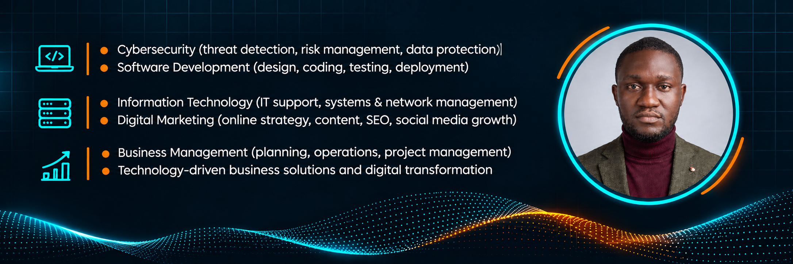

  

  

 

# Hi, I'm Okeke Ikechukwu F. 👋

## About Me
I'm interested in **cybersecurity, software development, information technology, digital marketing, and business management**. I enjoy exploring how technology and creative thinking can solve real-world problems, strengthen digital security, and support business growth.

## Areas of Interest
- 🔐 **Cybersecurity:** Network security, data protection, and security awareness
- 💻 **Software Development:** Building and improving practical digital solutions
- 🌐 **Information Technology:** IT systems, troubleshooting, and emerging technologies
- 📣 **Digital Marketing:** Social media strategy, content creation, and online branding
- 📊 **Business Management:** Entrepreneurship, operations, and business development

## What I'm Working Toward
- Expanding my technical and professional skills
- Exploring projects that connect technology with business needs
- Learning, collaborating, and sharing useful ideas
- Developing secure, effective, and user-friendly solutions

## Let's Connect
I'm open to exchanging ideas, learning from others, and exploring meaningful collaborations.

> **My focus:** Learn continuously. Build thoughtfully. Create impact.
